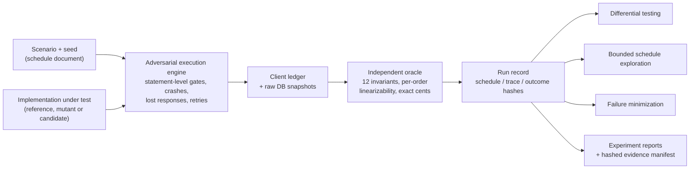

# GAUNTLET

**Adversarial evaluation of database-migration code under concurrency, partial failure and retries.
Research prototype. Software version 0.4.1; benchmark version 0.3.0.**

> **Status, in one paragraph.** GAUNTLET is an *instrument* for testing whether migration code that passes
> ordinary tests stays correct when execution turns adversarial. It has been validated only on
> hand-written reference implementations, hand-written mutants and labelled synthetic fixtures. **No study
> of an AI coding agent has been run**: one candidate generated with Gemini has been evaluated once, inside a
> disconnected VM, as a demonstration ([research/gemini-attempt2-results.md](research/gemini-attempt2-results.md)).
> **No execution mode is a security boundary** for untrusted code. All validation was run by the author and
> has not been independently reproduced.

> [!WARNING]
> **GAUNTLET does not sandbox untrusted code.** `process` mode is a development sandbox for code you trust:
> a candidate runs as your operating-system user, next to a harness that holds the database administrator
> credentials, and candidate code can read your files and open network connections (plain Python is enough
> to switch off GAUNTLET's in-process guard). `strict` (container / VM) isolation is not implemented and
> always refuses to run. **Do not run AI-generated or otherwise untrusted candidates in `process` mode on a
> machine you care about.** If you must evaluate such code, run GAUNTLET inside a disposable VM with no
> network and no shared folders. See [SECURITY.md](SECURITY.md).

## The problem

Online schema migrations run while old and new application versions share one database. A migration
that changes how money is stored, for example `orders.total NUMERIC(12,2)` → `orders.total_cents BIGINT`,
must stay exact to the cent while a legacy writer keeps writing, a backfill runs in batches, processes
crash between transactions, responses are lost and clients retry, and steps are repeated or resumed.

Conventional functional tests run one client at a time, against a database nobody else is writing to,
with no crashes. A backfill that copies a value it read a moment ago, a dual write split over two
transactions, or a retry that is applied twice all pass such tests. They fail only under particular
interleavings or faults, which ordinary tests do not produce and cannot reproduce on demand.

GAUNTLET makes those conditions explicit, controllable and replayable, and judges every run with an
oracle that does not trust the implementation's own reports.

## How it works



1. A **scenario** and **seed** produce a schedule document: which client calls what, when the migrator
   runs, where to crash, which response to drop, how statements interleave.
2. The **engine** runs each actor (legacy app V1, new app V2, migrator) in its own OS process. Every SQL
   statement waits at a gate until a single-threaded controller grants it, so interleavings, crashes and
   lost responses happen at exact statement boundaries, reproducibly, without knowing the implementation's
   code.
3. The **oracle** judges the run from what clients observed (an append-only ledger) and raw database
   snapshots: 12 safety, recovery and compatibility invariants, including a per-order linearizability
   check in exact integer cents. It imports no implementation code.
4. The run is stored with hashes of its schedule, statement trace and outcome; `replay` re-executes it
   and compares them.

## Capabilities and limitations

| Capability | Status | Bound / caveat |
|---|---|---|
| Statement-level adversarial execution, crash / lost-response / retry injection | Implemented, tested | Statement granularity only; READ COMMITTED; PostgreSQL 16 |
| Independent oracle (12 invariants) | Implemented, tested | Same author as references and mutants; diagnoses mean "consistent with", not root cause |
| Benchmark matrix and conventional baseline | Implemented; v0.1.0–v0.3.0 results frozen | One task family; one small conventional suite |
| Differential testing | Implemented, tested | Agreement is not correctness |
| Schedule exploration | Implemented, tested | One interleave directive, ≤ N preemptions (default 1); no crash-point exploration, no partial-order reduction |
| Failure minimization | Implemented, tested | Unit deletion only; 1-minimal, not globally minimal |
| Experiment reports with evidence manifests | Implemented, tested | Manifest stored in the same database (detects accidental change, not tampering) |
| External-candidate pipeline | Implemented; exercised with synthetic fixtures and one AI-generated candidate | `process` isolation is **not** a security boundary; `strict` isolation not implemented |
| AI-agent evaluation | **One demonstration run; no study** | A study needs a fixed protocol, many attempts and a verified isolation boundary |
| Independent reproduction | **Not done** | All validation author-run |

The analyses are described in [docs/ANALYSES.md](docs/ANALYSES.md) and the candidate pipeline in
[docs/CANDIDATES.md](docs/CANDIDATES.md).

## Results

Synthetic results, revalidated during the v0.4.0 release review; details and caveats in
[research/results-summary.md](research/results-summary.md) and
[docs/RESULTS_OVERVIEW.md](docs/RESULTS_OVERVIEW.md).

| Result | Evidence |
|---|---|
| The oracle passes both reference strategies on every benchmark run (36/36) and kills all 8 hand-written mutants with their *intended* invariant | Frozen v0.3.0 benchmark `bench-eed0c47427`: 180 runs (6 scenarios × 10 implementations × seeds 1–3), 121 pass, 59 fail, 0 inconclusive, 0 infrastructure errors; totals recomputed from the raw run rows |
| Runs are logically reproducible | 60/60 benchmark re-runs identical in schedule, trace and outcome hash and verdict; demo replays identical; a re-execution on v0.4.1 matched the frozen v0.3.0 evidence in 180 of 180 cells |
| 4 mutants pass all 10 conventional tests but fail adversarial runs (m1, m3, m7, m8; m2's conventional result is inconclusive in v0.3.0) | Same benchmark |
| Differential testing separates harmful from harmless differences | `ref_a_trigger` vs `m1_stale_backfill` on S02: **confirmed violation**; `ref_a_trigger` vs `ref_b_dualwrite`: **agreement** despite different internal bookkeeping |
| Bounded exploration finds and replays the backfill race | `F01_backfill_race_probe` × m1: all 18 schedules with ≤ 1 preemption executed, 5 fail in 1 failure class, replay reproduced |
| Minimization shrinks a failing schedule and keeps its failure signature | S02 × m1: 104 → 19 directives (390 → 51 trace events), 1-minimal with respect to unit deletion, independent replay matches |
| The external-candidate pipeline works end to end on a **synthetic** fixture | Content-hashed snapshot, evaluation, experiment report, evidence manifest 5/5 unchanged |

**First run on AI-generated code (one attempt, not a study).** On 2026-11-07 one migration generated with
Gemini was evaluated once, on seed 1, inside a disconnected VM. It agreed with the reference in five
scenarios and failed one: in S05 (premature finalization) its finalize and contract steps do not check
for registered old-version (v1) application instances, and a later v1 request fails, a confirmed
`C1_COMPATIBILITY` violation, minimized from 48 to 16 directives and replayed. This demonstrates the pipeline on real AI output; it is not a measurement of Gemini or of any
model, and the raw records are not in this repository. Full record and limits:
[research/gemini-attempt2-results.md](research/gemini-attempt2-results.md).

## Architecture

`backend/gauntlet/` holds the engine (actor subprocesses and statement gates, the controller, fault
injection), the oracle (ledger, linearizability checker, invariants), the scenarios, the reference
implementations and mutants, the analyses, the external-candidate pipeline, a SQLite results store, the
FastAPI server and the command-line interface. `frontend/` is a React + TypeScript dashboard. Frozen
benchmark evidence is in `evidence/`. Components, data flow, design trade-offs and the full repository
layout: [docs/ARCHITECTURE.md](docs/ARCHITECTURE.md).

## Getting started

Requirements: Python ≥ 3.11, Node ≥ 18 (for the dashboard and the portable PostgreSQL download) and a
PostgreSQL 16 server. The recorded results were produced on **Windows 11**; the test suite and the
demonstration also pass in continuous integration on Windows Server 2025 and Ubuntu 26.04.1. The benchmark
has not been re-executed on Linux, `process`-mode resource limits are not verified there, and **macOS** has
not been run ([docs/GETTING_STARTED.md](docs/GETTING_STARTED.md#requirements-and-platforms)).

```bash
python -m venv .venv && source .venv/Scripts/activate      # macOS/Linux: source .venv/bin/activate
pip install -c backend/constraints.txt -e "backend[dev]"   # the pinned, tested dependency versions
python -m gauntlet pg install && python -m gauntlet pg init && python -m gauntlet pg start
export GAUNTLET_RESULTS_DB="$PWD/.gauntlet/demo.sqlite3"    # scratch results database
cd backend
python -m gauntlet diff --impls ref_a_trigger,m1_stale_backfill --scenario S02_backfill_vs_legacy_writes --seed 1
# -> CONFIRMED_VIOLATION  behaviour differs and the oracle FAILs: m1_stale_backfill: S7_LINEARIZABLE, S1_ACKED_DURABLE
```

`pg init` creates a local cluster with the published development credentials `gauntlet` / `gauntlet` for a
superuser on `127.0.0.1:55432`; they are not secrets, so do not use them on a shared or networked machine
([SECURITY.md](SECURITY.md)). Docker Compose and other PostgreSQL 16 servers are covered in
[docs/GETTING_STARTED.md](docs/GETTING_STARTED.md).

A one-command demonstration runs the same comparison, replays the failure, and shows both safety gates
refusing to execute a candidate (about 30 s; it never executes candidate code):

```bash
bash scripts/run_demo.sh          # from the repository root; expect "checks passed: 9, failed: 0"
```

## Usage

```bash
python -m gauntlet scenarios                         # list scenarios
python -m gauntlet impls                             # list references and mutants
python -m gauntlet run --scenario S02_backfill_vs_legacy_writes --impl m1_stale_backfill --seed 1
python -m gauntlet replay <run_id>                   # re-execute a persisted run, compare hashes
python -m gauntlet report <run_id>                   # Markdown report for one run
python -m gauntlet serve                             # local API on http://127.0.0.1:8000
```

The dashboard runs with `cd frontend && npm install && npm run dev` (http://localhost:5173). **The API and
the dashboard have no authentication** and listen on the loopback interface only; keep it that way (do not
pass `--host`). All commands, configuration variables and dashboard views:
[docs/GETTING_STARTED.md](docs/GETTING_STARTED.md); every API endpoint: [docs/API.md](docs/API.md); the test
suite (585 tests): [docs/TESTING.md](docs/TESTING.md). Never point `GAUNTLET_RESULTS_DB` at a file in
`evidence/`; work on a copy.

## Security and limitations

* **No execution mode is a security boundary.** Candidate code in `process` mode can read host files
  (including the oracle), switch off the Python-level guard, read the harness's environment or memory and
  open network connections; `strict` (container/VM) isolation is not implemented and fails closed. The
  harness still holds PostgreSQL superuser credentials. Untrusted code belongs in a disposable,
  disconnected VM ([SECURITY.md](SECURITY.md), [docs/SECURITY_MODEL.md](docs/SECURITY_MODEL.md)).
* **The local API has no authentication**; it refuses requests relayed by a web browser, but anyone who can
  reach the port can use it. **The default database credentials** are a published development default.
* **No agent study.** One Gemini-generated candidate evaluated once is a demonstration and supports no
  failure rate. All other validation uses hand-written references and mutants and labelled synthetic
  fixtures, written by the same author as the oracle and the conventional suite.
* **Bounded search.** Interleavings are explored at SQL-statement granularity, exhaustively only within one
  interleave directive and a preemption bound; diagnoses S1/S2/S4/S6 mean "consistent with", not root cause.
* **Author-run, not independently reproduced.** Linux, Docker Compose and Python 3.11 are verified only in
  continuous integration; macOS has not been run. One conventional test in the v0.3.0 benchmark (m2, CT03)
  ended in an infrastructure error of unknown cause.
* Step-timeout attribution to a candidate is an evidence heuristic; a timeout is never a pass.

Full list: [docs/LIMITATIONS.md](docs/LIMITATIONS.md). Audit findings and their status:
[docs/SECURITY_FINDINGS.md](docs/SECURITY_FINDINGS.md).

## Documentation

The full index is [docs/README.md](docs/README.md). The main entry points:

| If you want to… | Read |
|---|---|
| Install, run and configure GAUNTLET | [docs/GETTING_STARTED.md](docs/GETTING_STARTED.md), [docs/DEMO.md](docs/DEMO.md) |
| Understand the engine and the oracle | [docs/ARCHITECTURE.md](docs/ARCHITECTURE.md), [docs/INVARIANTS.md](docs/INVARIANTS.md), [docs/FAULT_CATALOG.md](docs/FAULT_CATALOG.md), [docs/ANALYSES.md](docs/ANALYSES.md) |
| Use the API or evaluate an external candidate | [docs/API.md](docs/API.md), [docs/CANDIDATES.md](docs/CANDIDATES.md) |
| Check the security boundaries | [SECURITY.md](SECURITY.md), [docs/SECURITY_MODEL.md](docs/SECURITY_MODEL.md), [docs/LIMITATIONS.md](docs/LIMITATIONS.md) |
| Assess the method and the evidence | [docs/RESEARCH_METHODOLOGY.md](docs/RESEARCH_METHODOLOGY.md), [docs/RESULTS_OVERVIEW.md](docs/RESULTS_OVERVIEW.md), [evidence/](evidence/), [docs/REPRODUCIBILITY.md](docs/REPRODUCIBILITY.md), [research/technical-report.md](research/technical-report.md) |
| Run the tests | [docs/TESTING.md](docs/TESTING.md) |
| See what changed, and why v0.4.0 and v0.4.1 are each a single commit | [CHANGELOG.md](CHANGELOG.md), [docs/HISTORY.md](docs/HISTORY.md) |
| See what comes next | [research/open-questions.md](research/open-questions.md) |

## Contributing, licence and citation

* Contributions: see [CONTRIBUTING.md](CONTRIBUTING.md) and the [code of conduct](CODE_OF_CONDUCT.md).
  Independent reproduction reports are the most valuable contribution.
* Security: see [SECURITY.md](SECURITY.md). Report vulnerabilities privately.
* Changes: see [CHANGELOG.md](CHANGELOG.md).
* Licence: [Apache License 2.0](LICENSE); copyright notice in [NOTICE](NOTICE). It covers the whole
  repository, including the frozen evidence and results records. The repository contains no third-party
  source code. The software it depends on is installed separately and keeps its own licences, among them
  the LGPL-3.0 PostgreSQL driver psycopg: see [docs/THIRD_PARTY.md](docs/THIRD_PARTY.md).
* Citation: see [CITATION.cff](CITATION.cff).
